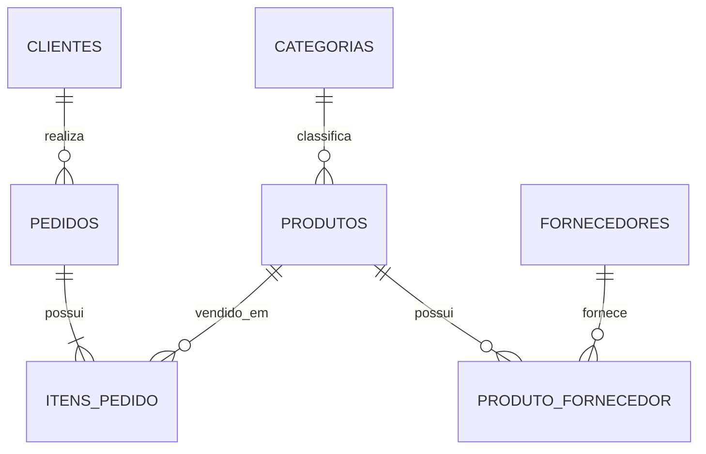

# 🥖 Projeto Final — Padaria

## Objetivo
Modelar e consultar uma padaria com:

- clientes;
- categorias;
- produtos;
- pedidos;
- itens de pedido;
- fornecedores;
- relação N:N produto ↔ fornecedor.

Arquivos:
- [[01-MODELAGEM-PADARIA]]
- [[02-CRIAR-BANCO-PADARIA]]
- [[03-POPULAR-PADARIA]]
- [[04-JOINS-PADARIA]]
- [[05-GROUP-BY-RELATORIOS]]
- [[06-DESAFIOS-PADARIA]]
