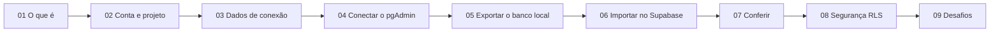

# ☁️ Módulo Supabase — Levando a Padaria para a nuvem

> [!INFO] Onde este módulo entra
> É o **último módulo** da apostila. Ele vem depois de [[06-SQL-AVANCADO/01-TRANSACOES|Transações]], do [[00-BANCO-LOJA|Banco Loja]] e do [[00-PROJETO-PADARIA|Projeto Padaria]], e usa o [[04-BACKUP-SEGURO-E-RESTAURACAO|Backup seguro]] como base.

> [!SUCCESS] Só o que funcionou
> Todo o passo a passo deste módulo foi **executado em aula (17/11/2026)** na turma `fullstack ter19h` e funcionou. Nada aqui é teoria não testada. Tudo é feito **com o mouse no pgAdmin**: sem terminal, sem pasta `bin`, sem copiar código do VS Code.

## 🎯 Objetivo

Ao final, você terá:

- [ ] uma **conta** no Supabase, criada por você;
- [ ] um **projeto** (um PostgreSQL na nuvem) só seu;
- [ ] o banco `padaria-b-max` **copiado** do seu computador para o Supabase;
- [ ] a prova, com uma consulta, de que os **números batem**;
- [ ] o banco **protegido** com RLS.

## 🧰 Antes de começar

| Item | Para quê |
|---|---|
| E-mail ou conta GitHub | Criar a conta no Supabase |
| pgAdmin 4 aberto | Fazer o backup, conectar e importar |
| Banco `padaria-b-max` com dados | É o que será migrado |
| Internet | O Supabase está na nuvem |
| Um gerenciador de senhas ou papel | Guardar a **senha do banco** (não dá para ver de novo) |

## 🗺️ Caminho do módulo

1. [[01-O-QUE-E-SUPABASE]]
2. [[02-CRIAR-CONTA-E-PROJETO]]
3. [[03-DADOS-DE-CONEXAO]]
4. [[04-CONECTAR-PGADMIN]]
5. [[05-EXPORTAR-BANCO-LOCAL]]
6. [[06-IMPORTAR-NO-SUPABASE]]
7. [[07-CONFERIR-MIGRACAO]]
8. [[08-SEGURANCA-RLS]]
9. [[09-DESAFIOS-SUPABASE]]
10. [[03-CHECKLIST-SUPABASE]] (em `10-CHECKLISTS`)

## ⏱️ Plano de aula sugerido (120 min)

| Bloco | Tempo | Conteúdo |
|---|---|---|
| Abertura | 20 min | O que é Supabase, limites, regras |
| Conta e projeto | 10 min | [[02-CRIAR-CONTA-E-PROJETO]] |
| Dados de conexão | 15 min | [[03-DADOS-DE-CONEXAO]] |
| Conectar o pgAdmin | 10 min | [[04-CONECTAR-PGADMIN]] |
| Exportar | 15 min | [[05-EXPORTAR-BANCO-LOCAL]] |
| Importar | 20 min | [[06-IMPORTAR-NO-SUPABASE]] |
| Conferir e proteger | 15 min | [[07-CONFERIR-MIGRACAO]] e [[08-SEGURANCA-RLS]] |
| Desafios | 15 min | [[09-DESAFIOS-SUPABASE]] |

## 📎 Material de apoio

- PDF da aula, colorido: `Aula_FullstackTer19h_Migrar_Padaria_Supabase.pdf` (nesta pasta).

> [!CAUTION] Regra de ouro
> A **senha do banco** e a chave **secret** nunca vão para o GitHub, para o WhatsApp da turma ou para print público. Veja [[08-SEGURANCA-RLS]].
