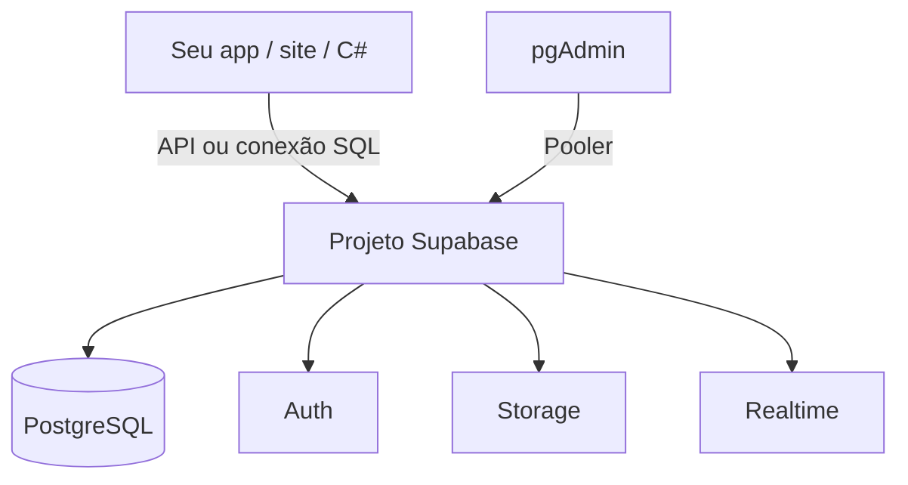

# 🧠 O que é o Supabase

> [!INFO] Em uma frase
> O Supabase é um **PostgreSQL na nuvem**, pronto para usar, com um painel no navegador e vários serviços extras em volta do banco.

Você já usa PostgreSQL no seu computador com o [[01-POSTGRESQL-E-PGADMIN|pgAdmin]]. No Supabase é o **mesmo PostgreSQL**, só que rodando em um servidor da internet. Os mesmos comandos SQL das aulas funcionam.

## 🏠 Local x ☁️ Supabase

| | Banco local | Supabase |
|---|---|---|
| Onde fica | No seu computador | Na nuvem |
| Quem acessa | Só você | De qualquer lugar, com a senha |
| Nome do banco | `padaria-b-max` | `postgres` (já vem criado) |
| `CREATE DATABASE` | Você cria | **Não precisa**: o projeto já é o banco |
| Servidor | Instalado por você | Mantido pelo Supabase |
| Uso em app | Só na sua máquina | Qualquer app (site, C#, Node) |

## 🧩 O que vem dentro do Supabase

| Parte | O que faz |
|---|---|
| **Database** | O PostgreSQL, que é o foco da apostila |
| **Studio** | O painel no navegador (Table Editor, SQL Editor) |
| **Supavisor (pooler)** | Porta de entrada que divide as conexões de forma eficiente |
| **Data API** | Gera uma API web automática para as suas tabelas |
| **Auth** | Login de usuários (e-mail, Google, GitHub) |
| **Storage** | Guarda arquivos (imagens, PDFs) |
| **Realtime** | Avisa o app quando um dado muda |
| **Edge Functions** | Pequenos códigos que rodam na nuvem |



## 📊 Hierarquia

```text
Conta
└── Organização
    └── Projeto  ← é aqui que mora o banco
        └── Database `postgres`
            └── Schema `public`
                └── Tabelas (clientes, produtos...)
```

## 💸 Limites do plano gratuito

> [!WARNING] Confirmar antes de prometer
> Os valores abaixo vieram de um artigo de terceiros. A página oficial **não foi consultada**. Confira em `supabase.com/pricing` antes de passar para os alunos.

| Item | Valor informado | Situação |
|---|---|---|
| Tamanho do banco | 500 MB | A confirmar |
| Usuários ativos por mês (Auth) | 50 mil | A confirmar |
| Tráfego de saída (egress) | 5 GB | A confirmar |
| Pausa por inatividade | Após cerca de 7 dias sem uso | A confirmar |
| Número de projetos grátis por conta | Não confirmado | Conferir no site |
| Exige cartão de crédito | Não confirmado | Conferir no site |

> [!TIP] Para a Padaria sobra espaço
> Quatro tabelas com algumas dezenas de linhas ocupam uma fração mínima de 500 MB. O risco real para aluno é o **projeto pausar** por falta de uso: basta abrir o painel de vez em quando.

## 🔑 Chaves de API (você vai ver na aula)

| Chave | Formato | Pode ir no front-end? |
|---|---|---|
| **Publishable** (substitui a antiga `anon`) | `sb_publishable_...` | Sim, **se o RLS estiver ligado** |
| **Secret** (substitui a antiga `service_role`) | `sb_secret_...` | **Nunca**: ignora o RLS |

As chaves antigas (`anon` e `service_role`) estão sendo substituídas pelas novas até o fim de 2026.

## ✅ Resumo

- Supabase é PostgreSQL na nuvem com painel e extras.
- O banco já vem criado, com o nome `postgres`.
- O plano grátis é ótimo para estudo, mas **confirme os limites no site oficial**.
- A segurança depende de **RLS** e de **não vazar senha nem chave secret**.

Próximo: [[02-CRIAR-CONTA-E-PROJETO]]
