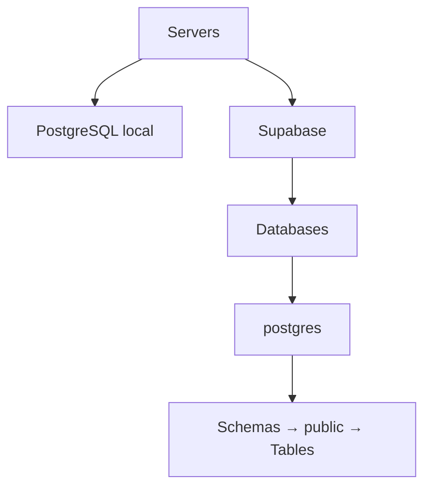

# 🔗 Conectar o pgAdmin ao Supabase

Você vai **cadastrar um segundo servidor** no pgAdmin. O servidor local continua lá, intacto.

## Passo a passo (só mouse)

1. No pgAdmin, na árvore à esquerda, clique com o **botão direito em `Servers`**.
2. Escolha **Register → Server...**
3. Aba **General**:

| Campo | Valor |
|---|---|
| **Name** | `Supabase` |

4. Aba **Connection**:

| Campo | Valor |
|---|---|
| **Host name/address** | Host do pooler ([[03-DADOS-DE-CONEXAO]]) |
| **Port** | `5432` |
| **Maintenance database** | `postgres` |
| **Username** | `postgres.<ID-do-projeto>` |
| **Password** | A senha do banco |
| **Save password?** | Ligado (opcional) |

5. Clique em **Save**.
6. O servidor **Supabase** aparece na árvore. Abra **Supabase → Databases → postgres**.

> [!SUCCESS] Como saber que deu certo
> Aparece **Supabase → Databases (1) → postgres** na árvore, sem mensagem de erro.

## Se der erro

| Mensagem | Causa | O que fazer |
|---|---|---|
| `Network is unreachable` | Você usou o host **direto** (IPv6) | Use o host do **Session pooler** |
| `password authentication failed` | Senha ou usuário errado | Confira se o usuário é `postgres.<ID>` e redigite a senha |
| `Tenant or user not found` | Usuário sem o ID do projeto | Use `postgres.<ID-do-projeto>` |

## Dicas

> [!TIP] Janela "Create - Server Group"
> Se abrir uma janela **Create - Server Group** sem querer, clique em **Close**. Você não precisa de grupo.

> [!TIP] Aviso "Request failed with status code 500"
> Um aviso vermelho com esse texto pode aparecer ao abrir ferramentas. Se o servidor está conectado, feche o aviso e abra de novo a aba do Query Tool.

Próximo: [[05-EXPORTAR-BANCO-LOCAL]]
