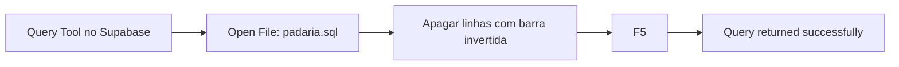

# 📥 Importar o `padaria.sql` no Supabase

Você vai abrir o arquivo dentro do **Query Tool do Supabase** e executar. Nada de copiar e colar.

> [!CAUTION] Confira o banco antes de executar
> Olhe o **título da aba** do Query Tool. Ele deve mostrar `postgres/postgres.<ID>@Supabase`. Se aparecer `padaria-b-max`, você abriu o Query Tool do banco **local**. Feche e abra no lugar certo. Esse é o mesmo cuidado de [[03-QUERY-TOOL-SEGURANCA]].

## Passo a passo

1. Na árvore, vá em **Supabase → Databases → postgres**.
2. Clique com o **botão direito** em `postgres` → **Query Tool**.
3. Confirme no título da aba: `...@Supabase`.
4. Clique no ícone de **pasta** (Open File), no topo do Query Tool.
5. Escolha o arquivo `padaria.sql`.
6. O conteúdo do arquivo aparece no editor.
7. **Apague a linha `\restrict ...`** (perto da linha 5). Se existir uma linha `\unrestrict ...` no final do arquivo (use **Ctrl+End**), apague também.
8. Aperte **F5** (ou clique no botão ▶ **Execute**).
9. Espere **Query returned successfully** na aba **Messages**.



> [!NOTE] Linhas `\restrict`
> O `pg_dump` de versões recentes pode gerar linhas `\restrict` e `\unrestrict`. Elas são comandos do `psql`, não SQL, então o Query Tool não as entende.

## Avisos que podem aparecer

| Aviso | O que significa |
|---|---|
| `already exists` em algum objeto | Aviso, pode seguir |
| Erro em `CREATE TABLE` ou `INSERT` | Pare e chame o professor |

## Para repetir do zero

Se precisar rodar de novo, apague só as tabelas da Padaria antes:

```sql
DROP TABLE IF EXISTS itens_pedido, pedidos, produtos, clientes CASCADE;
```

> [!DANGER] `DROP` é destrutivo
> Confirme que você está no **Supabase** e no **seu** projeto. Reveja o [[01-CHECKLIST-SEGURANCA]] antes de qualquer `DROP`.

Próximo: [[07-CONFERIR-MIGRACAO]]
